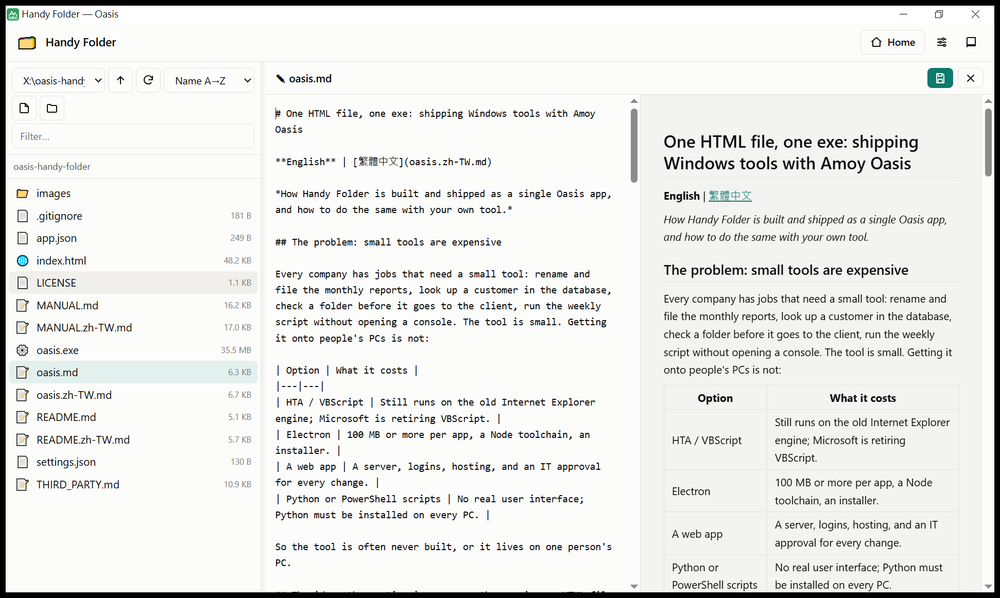
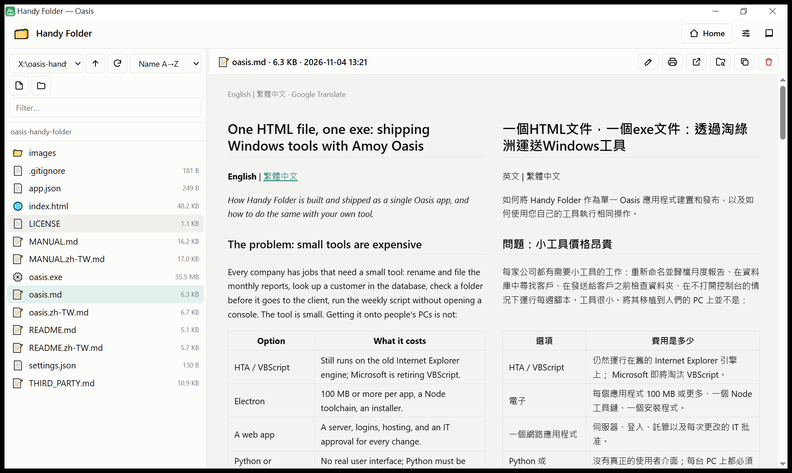
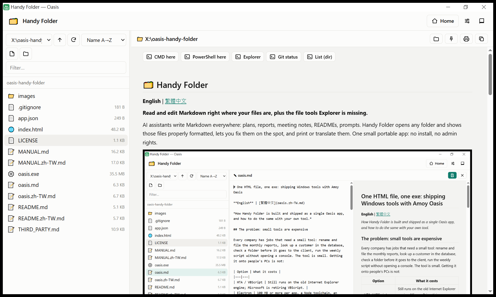

# 🗂️ Handy Folder

**English** | [繁體中文](README.zh-TW.md)

**Light and portable: read and edit Markdown, and most other files, right where they are.**

AI assistants write Markdown everywhere: plans, reports, meeting notes, READMEs, prompts. Handy Folder opens any folder and shows those files properly formatted, lets you fix them on the spot, and print or translate them. The same goes for HTML, JSON, text and code. The whole app is one folder of about 36 MB: no install, no admin rights, runs from a USB stick.



## Markdown first

- **Read it formatted.** Headings, tables, code, math, and the images next to the file. Links between documents work. Open a folder and its README is shown at once.
- **Edit in place, side by side.** Text on the left, live preview on the right; one click hides the preview for a full-width editor. **Ctrl+S** saves and keeps the previous version, so a bad edit is never final.
- **Print or save as PDF** for people who do not read Markdown.
- **English → 繁體中文.** Right-click a page to read it in Chinese, or both languages side by side.



## View and edit most files

- **View:** HTML in a safe frame, JSON and CSV as tables, PDF, images, and text and code with line numbers.
- **Edit directly:** HTML, JSON, CSV, TXT, logs, CSS, JavaScript, Python, PowerShell, batch, INI, YAML, SQL and other text files open in the same editor. Every save keeps the previous version.

## And a handier Explorer

- **Safe click.** Clicking a file only shows it. **► Run** runs scripts (`.py`, `.ps1`, `.bat` …) with live output.
- **Folder tools:** CMD here, PowerShell here, Explorer, Git status, and your own commands.
- **Your home page** of folder, file, web and command shortcuts.
- **Drop files** from Explorer onto the list to copy them in. Rename, reveal, copy path, move to trash (it can be brought back).

## Light and portable

- **One folder, about 36 MB:** `oasis.exe` (the runtime) and a 50 KB `index.html` (the whole app).
- **No install, no admin rights.** Unzip, double-click, done. It also runs from a USB stick or a shared drive.
- **Everything stays in its folder:** your settings, home page, backups and trash. Copy the folder to take it with you; delete it to remove it.
- **Plain and open:** the app is one readable HTML file. You (or an AI assistant) can change it.



## How it compares

| | Handy Folder | File Explorer | VS Code | Typora / Obsidian |
|---|---|---|---|---|
| Shows Markdown formatted | ✔ | ✘ | ✔ (preview tab) | ✔ |
| Edit with live preview | ✔ plain text + preview | ✘ | ✔ | ✔ richer editors |
| Works on any folder as it is | ✔ | ✔ | ✔ | ✔ (Obsidian adds its own vault settings) |
| Run scripts, folder tools | ✔ | partly | ✔ | ✘ (not built in) |
| Setup | none: one portable folder | built in | installer or zip | installer |

Handy Folder is not a full editor. It is the quick place to read, check and fix the Markdown in your folders, and to do the everyday file jobs around it.

## Quick start

1. Download this repository (**Code › Download ZIP**) and unzip it anywhere.
2. Double-click **`oasis.exe`**.
3. To open a folder straight away, drop the folder onto `oasis.exe`.

The first time you press ► Run or a folder tool, Oasis asks once whether this app may run commands. `oasis.exe` is not code-signed yet, so Windows may warn about an unknown publisher: choose **More info › Run anyway** if you trust this copy.

📖 **Manual:** [MANUAL.md](MANUAL.md) (繁體中文: [MANUAL.zh-TW.md](MANUAL.zh-TW.md)). Inside the app, press **F1**.

## What is in the folder

```
oasis-handy-folder\
├─ oasis.exe        the runtime: Amoy Oasis 0.3.1-beta (Go + WebView2)
├─ index.html       the whole app: HTML, CSS and JavaScript in one file (about 800 lines)
├─ app.json         title, icon and the permissions the app asks for
├─ MANUAL.md        the user manual (MANUAL.zh-TW.md in Chinese)
├─ oasis.md         how a single Oasis app is built and shipped (oasis.zh-TW.md in Chinese)
├─ images\          the screenshots on this page
├─ LICENSE, THIRD_PARTY.md
├─ settings.json, home.md    made on the first run: your settings (not in git)
└─ .oasis\          made on the first run: log, permissions, backups, trash (not in git)
```

## Built with Amoy Oasis

Amoy Oasis turns an HTML page into a Windows desktop app. Put `oasis.exe` next to an `index.html` and double-click: the page gets a window and a JavaScript API for files, commands, databases, HTTP and AI, inside a sandbox with permissions the user approves.

Handy Folder is one such app. **[oasis.md](oasis.md)** shows how to build and ship your own, from a ten-line "hello" to deployment and updates.

**Want tools like this for your company?** Amoy Technology builds and deploys Oasis apps for teams: internal tools, database front ends, reports, file workflows, often in hours. Website: https://amoy-tech.com · Contact: info@amoy-tech.com

## Requirements

- Windows 10 or 11, 64-bit, with the Microsoft Edge WebView2 Runtime (Windows already has it).
- Optional: the programs you want to run (Python, Node, Git, VS Code …).
- The Excel preview needs the Oasis `excel` extension, which this package does not include; use **Open** for Excel files.

## Security

- Commands run only when you press ► Run, a folder tool or a `run:` link, with your Windows rights.
- The app may use its own folder; other folders only after you allow them, or for one run when you name them on the command line.
- HTML files are shown in a sandboxed frame. **Translate** sends the page text to Google; nothing else leaves your PC.

## License

MIT, see [LICENSE](LICENSE). `oasis.exe` contains third-party software, see [THIRD_PARTY.md](THIRD_PARTY.md).

© 2026 CK Hung, Amoy Technology.
