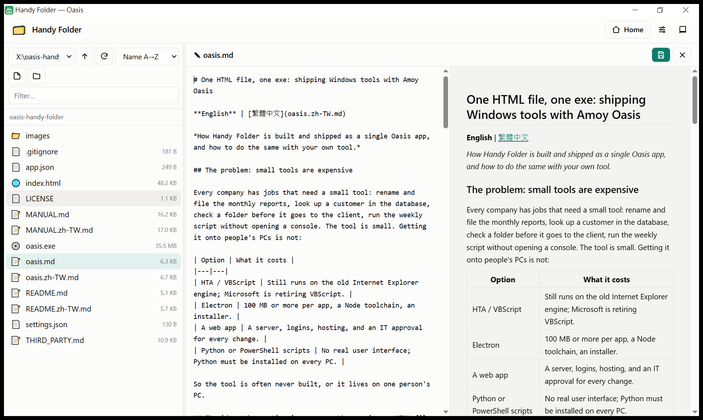
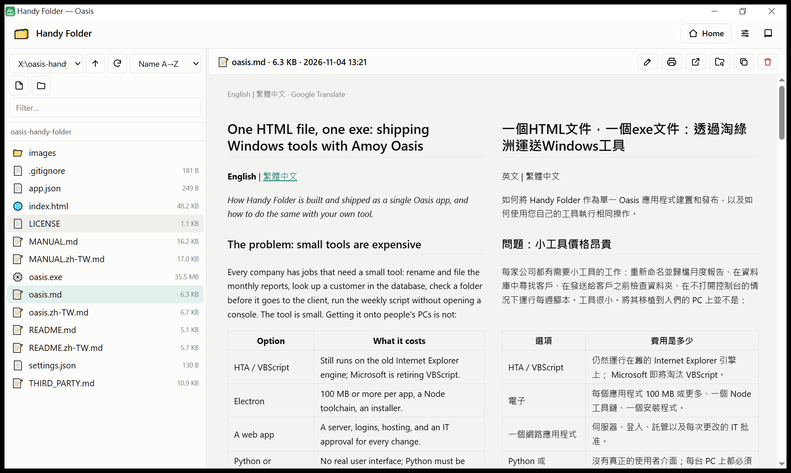
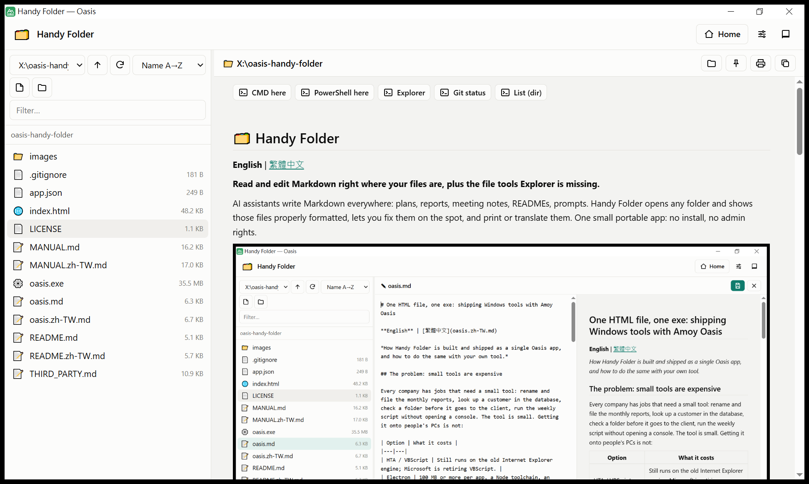

# 🗂️ Handy Folder

[English](README.md) | **繁體中文**

**輕巧、免安裝：在資料夾裡直接看、直接改 Markdown，其他大部分檔案也一樣。**

現在用 AI 工作，產出的幾乎都是 Markdown：計畫書、報告、會議紀錄、README、提示詞。Handy Folder 打開任何資料夾，就能把這些檔案排版好給你看，看到問題當場就改，還能列印或翻譯。HTML、JSON、純文字和程式碼也能直接看、直接改。整個 app 就是一個約 36 MB 的資料夾：免安裝、不需要管理員權限，放在隨身碟也能跑。



## Markdown 是主角

- **排版好再看**：標題、表格、程式碼、數學式，以及檔案旁邊的圖片都會正確顯示，文件之間的連結也點得開。進入資料夾時，會直接顯示它的 README。
- **左右並排，直接修改**：左邊改文字，右邊即時預覽；按一下就能收起預覽，變成全寬的編輯區。按 **Ctrl+S** 存檔時會自動保留上一版，改錯了也不怕。
- **列印或存成 PDF**：方便交給不看 Markdown 的同事或主管。
- **英文看不順？轉成繁體中文**：在頁面上按右鍵，可以切換成中文，或中英對照。



## 大部分檔案都能看、能改

- **直接看**：HTML 放在隔離的框架裡顯示，JSON 和 CSV 直接變成表格，還有 PDF、圖片，以及附行號的文字檔和程式碼。
- **直接改**：HTML、JSON、CSV、TXT、記錄檔、CSS、JavaScript、Python、PowerShell、批次檔、INI、YAML、SQL 等文字檔，都用同一個編輯器打開修改，按 **Ctrl+F** 可以搜尋文字。每次存檔都會保留上一版。

## 比檔案總管更順手

- **點了不會亂跑**：點檔案只會預覽；要按 **► Run** 才會執行 `.py`、`.ps1`、`.bat` 等腳本，輸出即時顯示。
- **資料夾工具**：在這裡開 CMD、開 PowerShell、開檔案總管、看 Git 狀態，也能加上你自己的指令。
- **自己的首頁**：把常用的資料夾、檔案、網址和指令做成捷徑。
- **拖放複製**：從檔案總管把檔案拖進清單就會複製過來。另外還有改名、在檔案總管中顯示、複製路徑、移到垃圾桶（可以救回來）。

## 輕巧、可攜

- **一個資料夾，約 36 MB**：`oasis.exe`（執行環境）加上 50 KB 的 `index.html`（整個 app）。
- **免安裝、不需要管理員權限**：解壓縮、雙擊，就能用。放在隨身碟或共用磁碟上也能執行。
- **所有東西都留在資料夾裡**：你的設定、首頁、備份和垃圾桶。複製資料夾就能帶著走，刪掉資料夾就移除乾淨。
- **簡單、看得懂**：整個 app 是一個 HTML 檔，你自己（或 AI 助理）都能直接修改。



## 跟其他工具比較

| | Handy Folder | 檔案總管 | VS Code | Typora / Obsidian |
|---|---|---|---|---|
| Markdown 排版顯示 | ✔ | ✘ | ✔（預覽分頁） | ✔ |
| 編輯時即時預覽 | ✔ 純文字加預覽 | ✘ | ✔ | ✔ 編輯器更強 |
| 直接用在任何資料夾 | ✔ | ✔ | ✔ | ✔（Obsidian 會加上自己的筆記庫設定） |
| 執行腳本、資料夾工具 | ✔ | 部分 | ✔ | ✘（未內建） |
| 安裝 | 不用，一個資料夾帶著走 | 內建 | 安裝程式或 zip | 安裝程式 |

Handy Folder 不是完整的編輯器。它的定位是：快速打開資料夾裡的 Markdown 來看、檢查、修改，順便處理日常的檔案工作。

## 三步開始用

1. 下載這個 repository（**Code › Download ZIP**），解壓縮到任何位置。
2. 雙擊 **`oasis.exe`**。
3. 想直接打開某個資料夾？把資料夾拖到 `oasis.exe` 上就行。

第一次按 ► Run 或資料夾工具時，Oasis 會問你是否允許這個 app 執行指令，只會問一次。`oasis.exe` 目前還沒有數位簽章，Windows 可能會跳出「發行者不明」的警告；確認檔案來源可信後，點 **其他資訊 › 仍要執行** 即可。

📖 **使用手冊**：[MANUAL.zh-TW.md](MANUAL.zh-TW.md)（英文版：[MANUAL.md](MANUAL.md)）。在 app 裡按 **F1** 也能直接打開。

## 資料夾內容

```
oasis-handy-folder\
├─ oasis.exe        執行環境：Amoy Oasis 0.3.1-beta（Go + WebView2）
├─ index.html       app 本體：HTML、CSS、JavaScript 全在這一個檔案（約 800 行）
├─ app.json         標題、圖示，以及 app 需要的權限
├─ MANUAL.md        使用手冊（中文版：MANUAL.zh-TW.md）
├─ oasis.md         如何製作與發布單一 Oasis app（中文版：oasis.zh-TW.md）
├─ images\          本頁截圖
├─ LICENSE、THIRD_PARTY.md
├─ settings.json、home.md    第一次執行時產生：你的個人設定（不進 git）
└─ .oasis\          第一次執行時產生：記錄檔、權限、備份、垃圾桶（不進 git）
```

## 背後的技術：Amoy Oasis

Amoy Oasis 能把一個 HTML 網頁變成 Windows 桌面程式。把 `oasis.exe` 放在 `index.html` 旁邊，雙擊即可：網頁會在自己的視窗中執行，並能透過 JavaScript 讀寫檔案、執行指令、連接資料庫、呼叫網路服務和 AI。這一切都在沙盒中進行，權限由使用者決定。

Handy Folder 就是用這種方式做出來的。想自己做一個？請看 **[oasis.zh-TW.md](oasis.zh-TW.md)**，從十行的入門範例一路講到部署和更新。

**貴公司也需要這樣的工具嗎？** Amoy Technology 專門為企業團隊量身打造並部署 Oasis app，包括內部工具、資料庫查詢介面、報表、檔案作業流程，很多需求幾個小時就能完成。網站：https://amoy-tech.com · 聯絡信箱：info@amoy-tech.com

## 系統需求

- Windows 10 或 11（64 位元），需有 Microsoft Edge WebView2 Runtime（Windows 已內建）。
- 選配：想用 ► Run 執行的程式，例如 Python、Node、Git、VS Code。
- Excel 預覽需要 Oasis 的 `excel` 擴充套件，本套件未附；Excel 檔請按 **Open** 用 Excel 開啟。

## 安全性

- 只有在你按下 ► Run、資料夾工具或 `run:` 連結時才會執行指令，權限和你自己開程式時相同。
- app 只能使用自己的資料夾；其他資料夾必須經你同意，或是你在命令列指定（只在那次執行有效）。
- HTML 檔在隔離的框架中顯示。**翻譯**功能會把頁面文字傳送到 Google，除此之外不會有任何資料離開你的電腦。

## 授權

MIT 授權，詳見 [LICENSE](LICENSE)。`oasis.exe` 包含第三方軟體，詳見 [THIRD_PARTY.md](THIRD_PARTY.md)。

© 2026 CK Hung，Amoy Technology。
